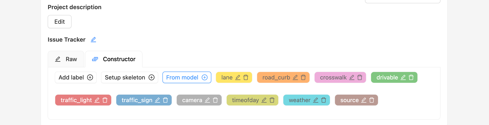
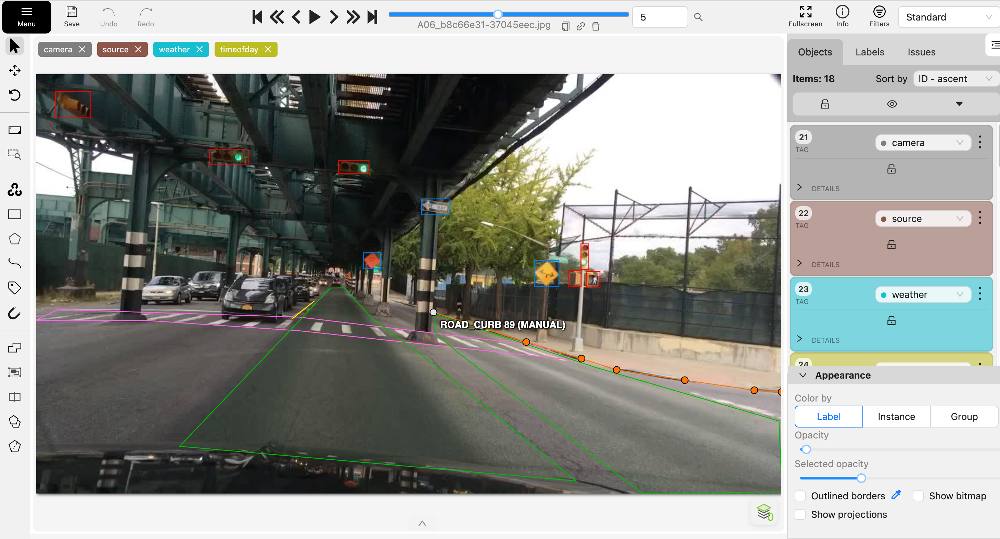
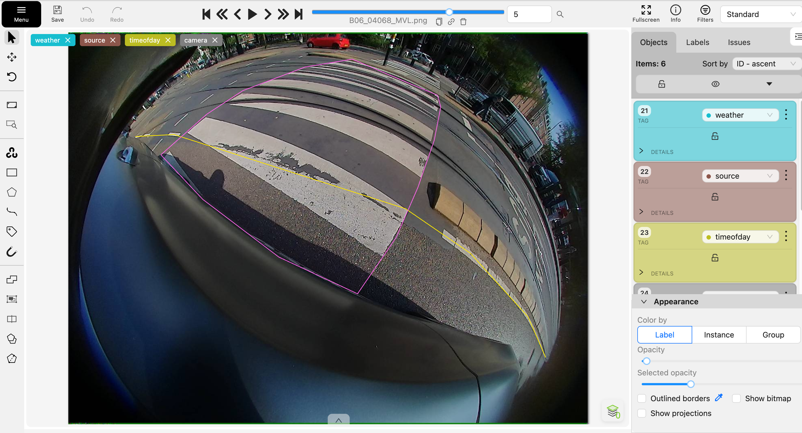

# Báo cáo cá nhân — Ngày 11
Họ tên: Vũ Việt Anh              Mã học viên:  2A202603214
Phiên bản CVAT (Help → About):  v2.74.1
Guideline: Road v1.0    Lần nộp (`revision` trong manifest):  1
Thời điểm export (ngày giờ trên CVAT):    Số lần nộp lại sau Rework:  0

## 1. Kiểm project
| Mục | Đúng như guideline Road v1.0? | Ghi chú |
| --- | --- | --- |
| 6 label, đúng kiểu | đúng  | Gồm: lane (polyline), road_curb (polyline), crosswalk (polygon), drivable (polygon), traffic_light (rectangle), traffic_sign (rectangle) |
| Thuộc tính và giá trị | đúng | lane: position, style, color, kind; drivable: area_type; đèn/biển: color, type, group, facing, edge_zone  |
| 4 tag ảnh | đúng | 4 tag mô tả camera/bối cảnh theo quy định  |
Cách kết thúc polyline trên bản CVAT này:  Nhấn phím N
Cách đặt tag ảnh trên bản CVAT này:  Mở bảng Objects bên phải -> chuyển sang tab Tags 

## 2. Số lượng đã gán
| Task | Ảnh | lane | road_curb | crosswalk | drivable | traffic_light | traffic_sign |
| --- | ---: | ---: | ---: | ---: | ---: | ---: | ---: |
| front | 12 | 33 | 11 | 4 | 22 | 21 | 20 |
| front-extra (đã làm _0_ / 4) |  |  |  |  |  |  |  |
| fisheye | 8 | 6 | 8 | 7 | 4 | 4 | 6 |
| fisheye-extra (đã làm __ / 4) |  |  |  |  |  |  |  |

## 3. Bảng ca khó
| Ảnh | Nhãn | Phân vân giữa | Đã chọn | Lý do |
| A05 | lane | Có vẽ L1, R1 hay không| Không vẽ | Mặt đường mờ/không có vạch kẻ làn rõ ràng theo quy tắc không đoán mò |
| A06 | lane R1 | Vẽ / không vẽ | Không vẽ | Bên phải không thấy vạch; coach đã xác nhận, được miễn QC1-02 |
| A09 | lane L2 (kind=double) | Một polyline / hai polyline | Hai polyline, cùng position | Vạch đôi gồm hai nét song song; theo hướng dẫn của coach, vẽ 2 đường và để cùng position |
| B03, B04, B08 | lane (3 điểm) | Thêm điểm / giữ nguyên | Giữ nguyên | Lint vẫn báo QC1-11 dù thêm hay bớt điểm; coach đã xem và xác nhận nên giữ nguyên |
| A10 | traffic_sign | Bỏ qua hay gán box nhỏ | bỏ qua | Vật thể ở xa có chiều cao ~8 px (ngưỡng ranh giới kích thước tối thiểu của guideline)|
## 4. Phiếu QC 1 nhận được
Bạn kiểm lô của tôi:  Quyết định nhận được:  
| Mã lỗi | Số lỗi | Đồng ý? | Đã sửa? |
| --- | ---: | --- | --- |

## 5. Kiểm file export
| File | Mở lại được? | Số shape ảnh 1 (job / file) | Số shape ảnh 2 (job / file) | Tag camera có trong XML? |
| VuVietAnh-front.zip | Có |A01: 9/9  |A02: 6/6 | Có |
| VuVietAnh-fisheye.zip | Có (đọc được 8 ảnh) | B01: 4/4 | B02: 3/3 | Có, fisheye_front / rear / left / right đúng theo FV / RV / MVL / MVR |

## 6. Ảnh chụp màn hình
## 6. Ảnh chụp màn hình







4. Một đoạn XML có `<polyline label="lane">`:

```xml
<polyline label="lane" source="manual" occluded="0" points="0.51,601.15;333.96,504.83" z_order="0">
  <attribute name="position">L1</attribute>
  <attribute name="style">solid</attribute>
  <attribute name="color">white</attribute>
  <attribute name="kind">single</attribute>
</polyline>
```

## 7. Tự đánh giá
Lỗi bạn mắc nhiều nhất hôm nay (theo mã QC1-xx), và cách tránh ở Ngày 20:  
Lỗi gặp nhiều nhất là QC1-02 (bỏ trống vạch kẻ làn ở ảnh A05, A06, A09 do mặt đường thực tế bị mờ/không có vạch) và QC1-05 (vẽ vạch đôi song song thành hai đường rời nhưng đặt cùng một tên vị trí).
Trước khi bắt đầu vẽ một ca khó (như vạch mờ hay vạch đôi), cần hỏi thống nhất quy tắc với người hướng dẫn ngay từ đầu và ghi chú lại để người kiểm tra sau hiểu đúng ý đồ, không bị chấm nhầm là lỗi
Nhãn của bạn đi vào model ở đâu? Chọn một lỗi đã sửa và nói nó làm model học sai thế nào:  
Nơi nhãn đi vào: Những đường kẻ và khung hình mình vẽ chính là "sách giáo khoa" (đáp án mẫu) để dạy cho AI của xe tự lái biết đâu là làn đường, đâu là biển báo và đâu là phần đường được phép chạy.
Tác hại của lỗi đã sửa: ở lỗi QC1-11(bật nhầm chế độ vùng rìa méo hình cho biển báo nằm ở ngay chính giữa ảnh B03), nếu không sửa lại, AI sẽ học nhầm rằng những biển báo phẳng phiu ở giữa tầm nhìn cũng bị méo mó như ở góc ống kính. Hậu quả là khi xe chạy thực tế, AI sẽ nhận diện sai hình dạng và đọc nhầm biển báo giao thông.
## 8. (Tùy chọn, buffer) Từ polyline đến đích row-anchor
| y | 720 | 680 | 640 | 600 | 560 |
| --- | ---: | ---: | ---: | ---: | ---: |
| x của chúng tôi |  |  |  |  |  |
| x của bạn kia |  |  |  |  |  |

Trả lời 3 câu:

1. Năm số x đó chính là đích mà một model row-anchor học cho vạch này. Nếu bạn dừng polyline sớm 40 px, hàng nào đổi thành "không có làn"?
2. So với bạn được kiểm (cùng ảnh): ở hàng 720 và hàng 560, hai bạn lệch nhau bao nhiêu pixel? Lệch ở hàng nào ảnh hưởng LKA nhiều hơn (slide 25)?
3. Nếu polyline vẽ từ xa về gần (ngược quy tắc 2), cách tính trên có đổi không? Script nào sẽ gặp khó?
